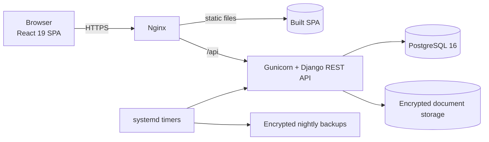
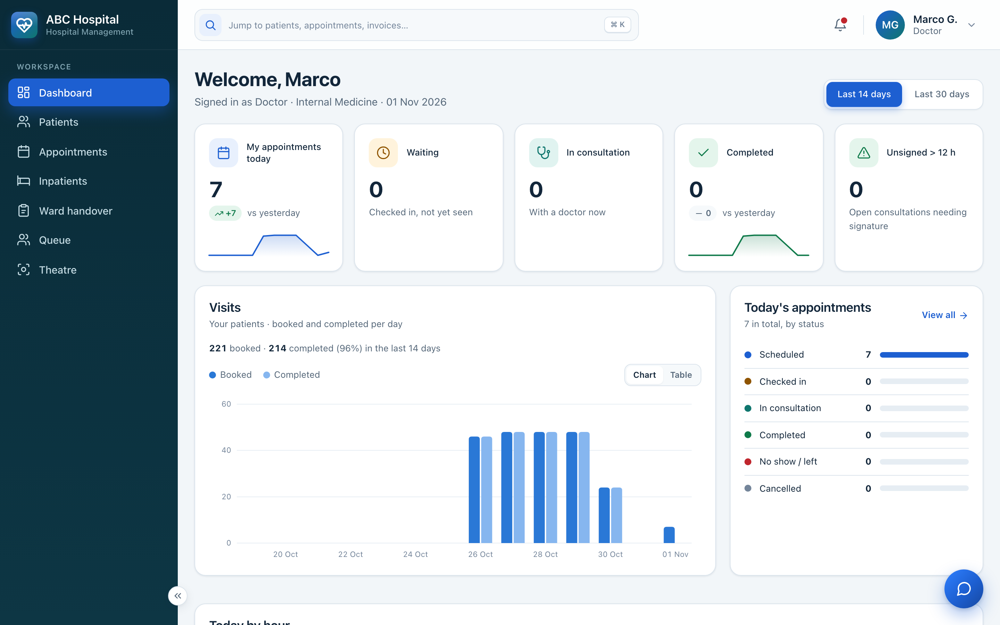
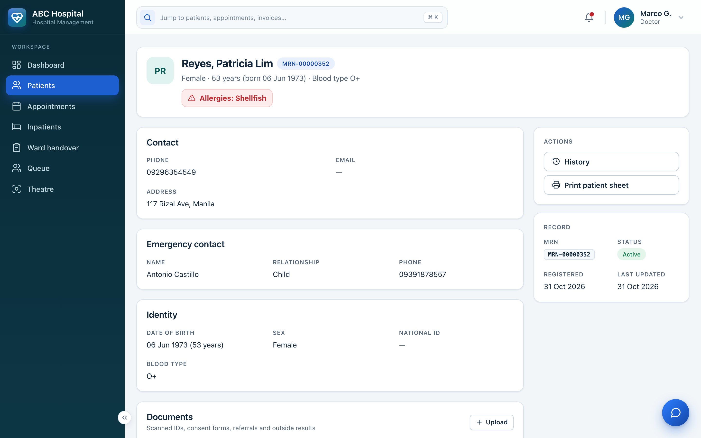
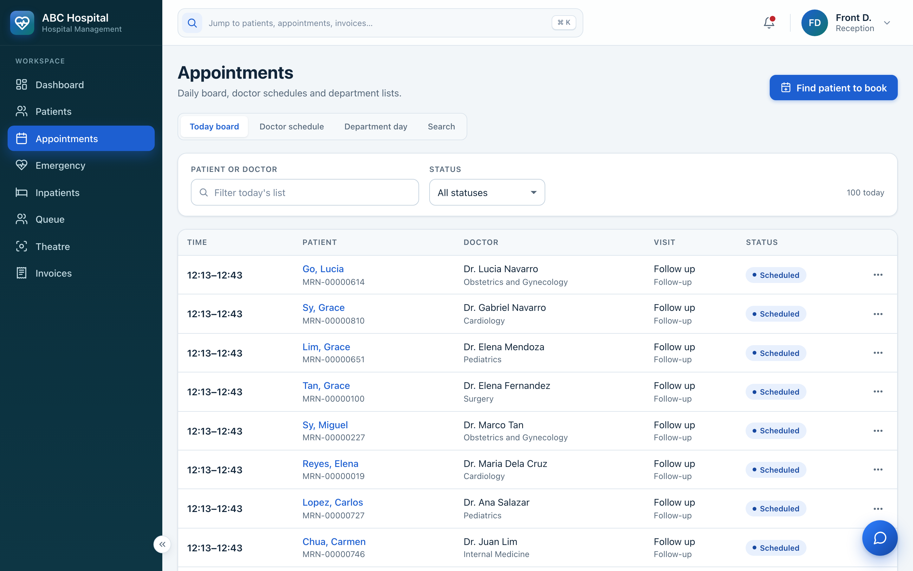
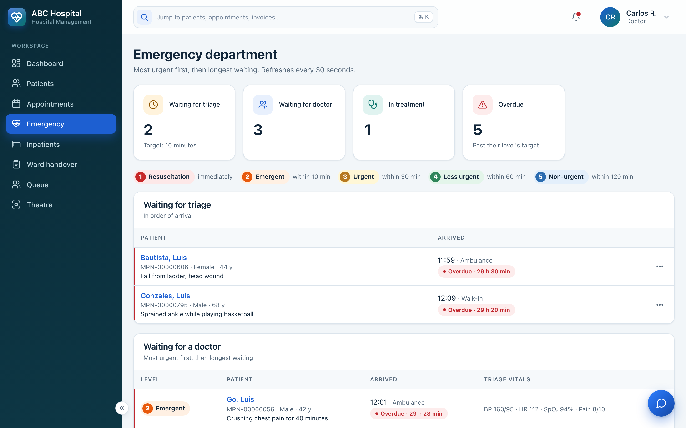
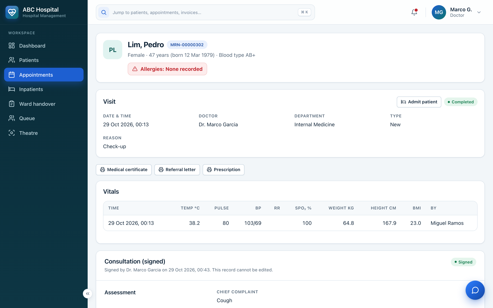
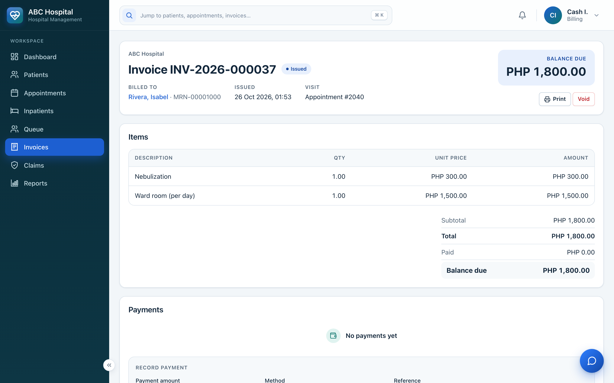
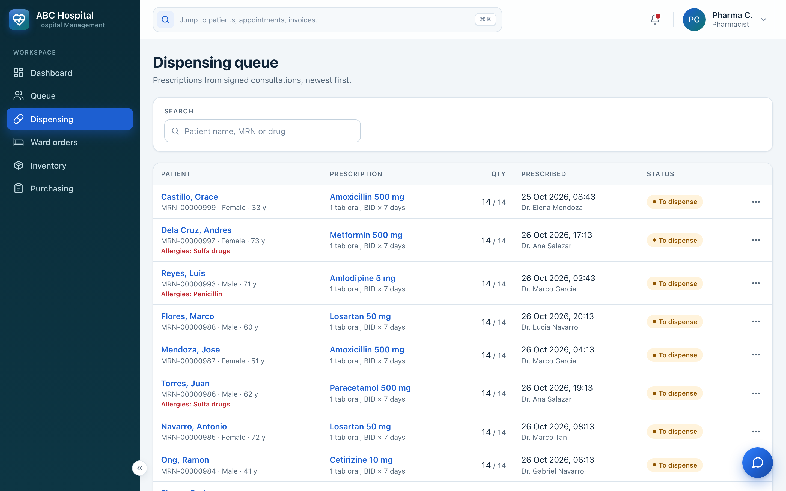
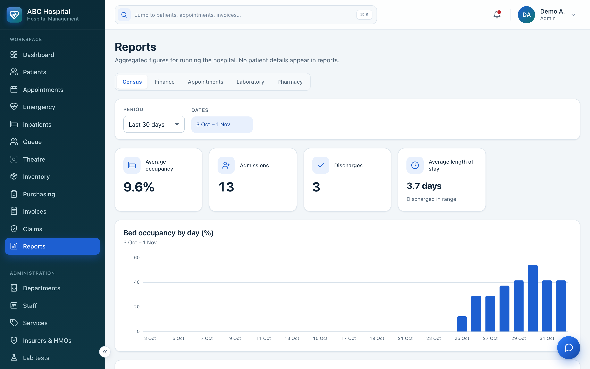

# 🏥 Hospital Management System

**One system for the whole hospital, from the front desk to the operating theatre.**

Patients, appointments, emergency triage, wards, laboratory, pharmacy, billing and insurance in a single web
app, with strict role-based access and a full audit trail of who saw and changed what.

> This is a product showcase. Want to see it running? A live walkthrough is available on request.

| 7 | 20+ | 500+ | 97% | < 20 ms |
|:---:|:---:|:---:|:---:|:---:|
| staff roles | hospital modules | automated tests | test coverage | patient search (p95) |

---

## What it covers

| Department | What staff can do |
|---|---|
| **Front office** | Register patients (automatic MRN), book into doctors' free slots, walk-ins, check-in, queue tickets with a waiting-room TV display, email and SMS reminders |
| **Clinics** | Vitals, notes, ICD-10 diagnoses, prescriptions and orders; signed notes are locked and later edits become audited amendments |
| **Emergency** | 5-level triage, a live ED board with target times, and outcomes: discharge, admit or transfer |
| **Wards** | Beds and admissions, transfers, census board, medication rounds (MAR), SBAR handovers, care plans, fluid balance |
| **Operating theatres** | Theatre bookings without double-booking, pre-op checklist, operation notes |
| **Laboratory** | Orders, sample collection, results with reference ranges and abnormal flags |
| **Pharmacy** | Dispensing from stock batches (earliest expiry first), inventory alerts, suppliers and purchase orders |
| **Billing** | Invoices, payments, refunds and receipts; HMO and insurance coverage with claims from submission to payment |
| **Documents** | Medical certificates, referrals, prescriptions and discharge summaries with a QR code anyone can verify; receipts, labels and wristbands |
| **Management** | Role-aware dashboards, reports with CSV export, staff accounts, audit log, built-in staff chat |

## Who uses it

| Role | Sees and does |
|---|---|
| Admin | Setup, staff, reports, audit log (no clinical notes) |
| Reception | Patients, appointments, ED arrivals, admissions, queue |
| Billing | Invoices, payments, refunds, insurance claims |
| Doctor | Consultations, orders, prescriptions, results, theatre |
| Nurse | Vitals, ward patients, medication rounds, triage, handovers |
| Lab tech | Lab worklist only |
| Pharmacist | Dispensing, inventory, purchasing |

---

## Built for patient safety

Hospital data can't be lost, doubled or quietly changed, so the critical rules live **in the database
itself**, not only in application code.

1. **Nothing is double-booked.** Doctors, patients, beds and operating rooms are protected by PostgreSQL
   exclusion constraints, proven by tests that hit the database from two connections at once.
2. **Signed records stay signed.** Consultations, released lab results, issued invoices and payments are frozen
   by database triggers. Corrections are added as new records, never overwrites.
3. **Every action leaves a trace.** An append-only audit log, partitioned by month, records every change and
   every view of clinical data. The app itself can't edit or delete it.
4. **Least privilege everywhere.** Each role sees only its own screens and patients, and the app's database
   user has no delete rights outside a short allowlist.
5. **Secure sign-in.** Two-factor authentication (TOTP with backup codes), idle timeouts, sign-in throttling,
   and patient data kept out of URLs and logs.
6. **Numbers without gaps.** Invoices, receipts, purchase orders and documents are numbered in sequence using
   row locks, as auditors expect.
7. **No lost reminders.** Messages go through a transactional outbox with retries.

---

## Technology

| | |
|---|---|
| Backend | Python 3.12, **Django 5.2 LTS**, Django REST Framework |
| Database | **PostgreSQL 16**: exclusion constraints, triggers, partitioning, trigram search |
| Frontend | **React 19**, TypeScript, Vite, React Router |
| Testing | pytest (366 tests), Vitest + Testing Library + MSW (66), **Playwright** end-to-end (70) |
| DevOps | GitHub Actions CI/CD, Nginx, Gunicorn, systemd, encrypted backups |
| Hosting | Runs on any Ubuntu server: **AWS EC2**, **Azure** VMs, **DigitalOcean** Droplets, or an **on-premise / local server** |
| Code quality | ruff, mypy, ESLint, `tsc`, pip-audit, npm audit, shellcheck, pre-commit hooks |

## How it fits together

More diagrams, including a patient's visit from reception to billing: [`docs/architecture.md`](docs/architecture.md).

## Testing and operations

- Every push runs linting, type checks, dependency audits, and backend, frontend and end-to-end tests before
  anything is deployed.
- Coverage must stay above 85% overall and 95% on business rules and permissions (currently 97% and 99%).
- Releases are smoke-tested after deploy and rolled back automatically if the health check fails.
- Nightly encrypted backups, plus a restore drill that checks every patient document against its SHA-256 hash.

---

## Screens

| | |
|---|---|
|  |  |
| **Doctor dashboard** | **Patient record** with allergy warning |
|  |  |
| **Appointments** board | **Emergency** triage board |
|  |  |
| **Signed consultation** | **Invoice** and payments |
|  |  |
| **Pharmacy** dispensing queue | **Reports** |

Generated demo data only. No real patient information is shown.

---

## About me

Full-stack developer working with **Django, React and PostgreSQL**. I designed and built this system end to
end: database, API, UI, tests and deployment.
