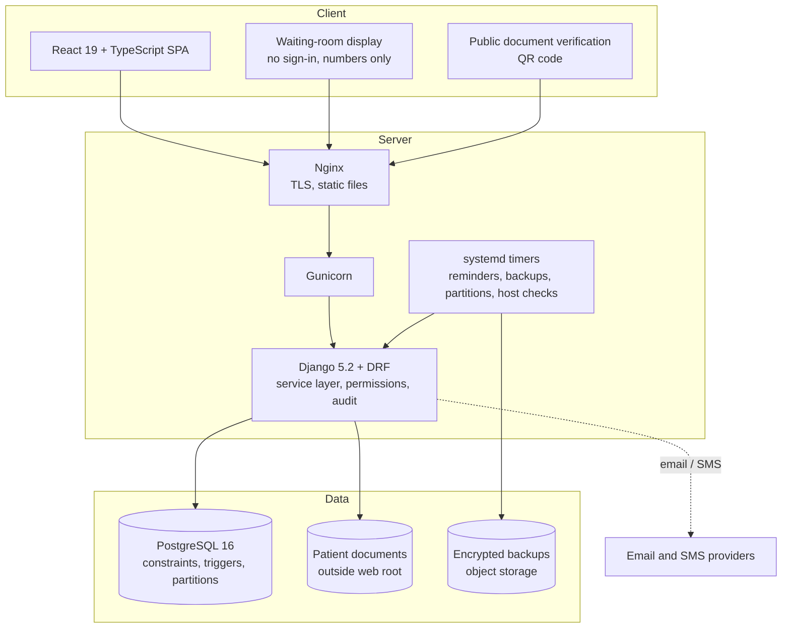
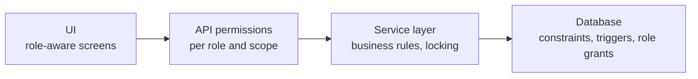
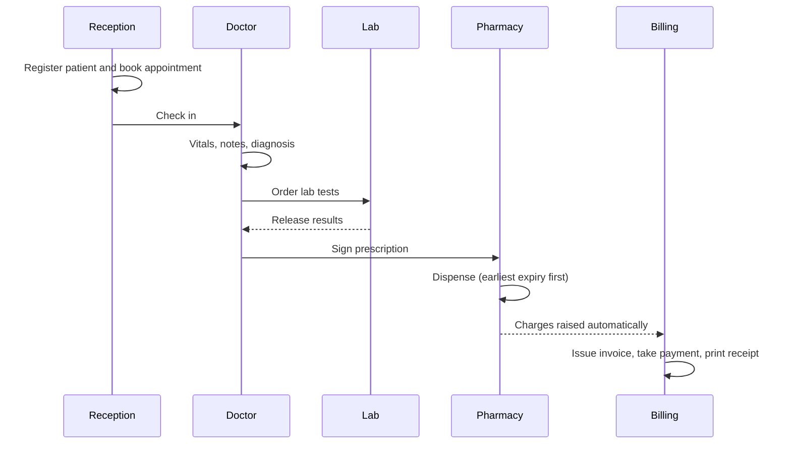
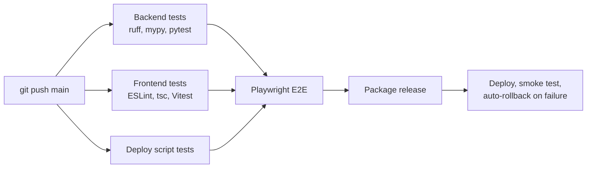

# Architecture

## System overview



## Backend modules

The Django backend has 23 apps, each with its own models, services, permissions and tests:

```
accounts      audit         departments   patients      scheduling
clinical      diagnostics   pharmacy      inpatient     emergency
billing       notifications documents     purchasing    nursing
theatre       queues        certificates  printouts     chat
reports       core
```

Business rules live in a **service layer** (`services.py`). Access rules are kept in separate
`permissions.py` and `scoping.py` modules so each role only reaches the patients it should.

## Layered enforcement



Each important rule is checked in more than one layer. For example, a signed consultation is refused by the
service layer **and** by a database trigger, so even a bug in application code can't change it.

## Patient visit flow



## Deployment pipeline


